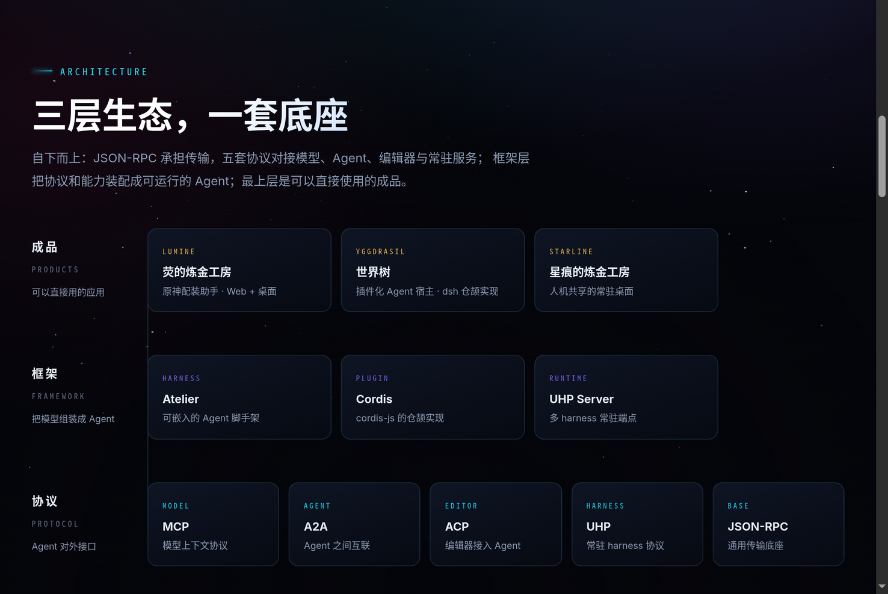
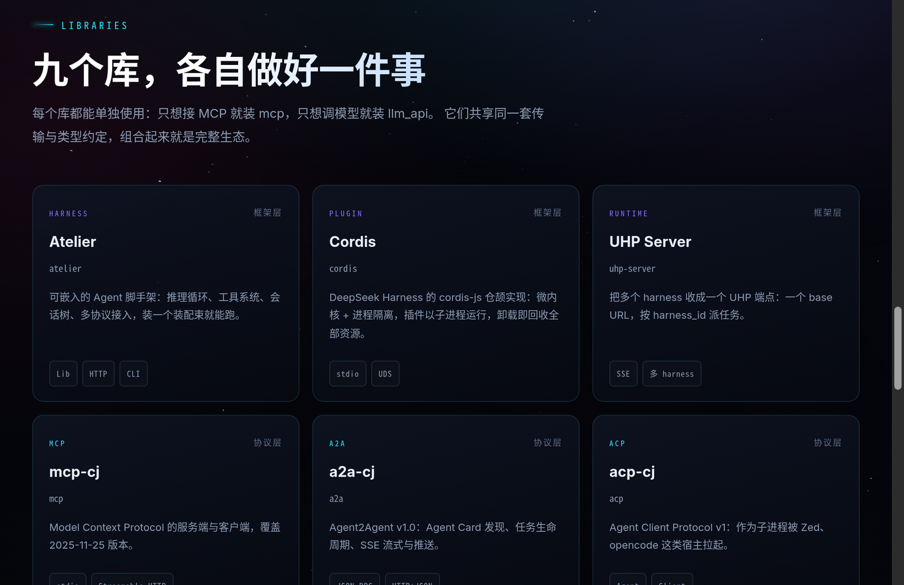

「让模型自己读文件、跑命令、改代码」——这句需求听起来简单，真做起来要先补六块：**推理循环、上下文压缩、工具系统、权限判定、会话持久化、对外协议**。

每块都不难，难的是写完还得让它们互相配合。而且这六块跟你的产品没关系——你的产品是那个领域里的判断，不是「怎么把工具结果塞回消息列表」。

仓颉上这套生态（[atelier-ai.top](https://atelier-ai.top)）就是把六块拆开、做成九个能单独用的库。这篇文章讲四件事：六块怎么变成九个库、两种用法各适合谁、四套协议各接哪个方向、以及你该从哪一层开始。

## 六个模块，九个库

三层的分工是清楚的。

**协议层**——Agent 对外怎么说话：

- MCP：给 Agent 装工具
- A2A：让 Agent 之间互相调用
- ACP：让编辑器拉起 Agent（类比编辑器侧的 LSP）
- UHP：把远端 harness 统一成端点（类比 harness 的 HTTP 标准接口）

前三套建在 `ystyle::jsonrpc` 上，所以形状一致；UHP 只依赖 stdx，走 HTTP 资源模型。

**框架层**——把模型组装成 Agent：

- `atelier`：可嵌入的脚手架，循环、压缩、工具、会话树都在里面（类似 Claude Agent SDK / pi 那类「把 Agent 嵌进你程序」的运行时）
- `cordis`：dsh 那套插件框架 Cordis 的仓颉实现——微内核 + 进程隔离，插件跑独立子进程，卸载即杀进程、由系统回收全部资源（静态语言卸载不了模块，只能这么做）
- `uhp-server`：多个 harness 收成一个端点，按 `harness_id` 派活（类似 API 网关）

**成品层**——可以直接用的应用：三个已经跑起来的，后面单独说。

六块加上「模型接入」和「插件、多端点」这些周边，最后切成九个库：四个协议、一个 `jsonrpc` 底座、`atelier` / `cordis` / `uhp-server` / `llm_api`。

九个库合计约 **7.2 万行纯仓颉实现**（不含测试）。规模不是重点，重点是**每个都能单独用**：

只想调模型？`llm_api` 一个包，OpenAI 兼容 / Anthropic / Ollama 一套接口通吃，到这就够了，不用引入 Agent 概念。

要给已有的 Agent 装能力？`mcp-cj` 一个包，覆盖 MCP 的 2025-11-25 版本，stdio 和 Streamable HTTP 都有。

要被 Zed、opencode 这类宿主拉起？`acp-cj`，它作为子进程跑，按 ACP v1 说话。

## 两种用法，方向相反

**一、给已有产品加一个 Agent。** 你已经有产品了，现在想让它自己干活：用户在对话框里说一句，程序去读文件、查数据、跑命令、改东西。这时候要的是一个**现成运行时**——循环、压缩、工具调度已经有人写好了，你只需要接上，再用 ACP 或 A2A 把它接到已有的宿主里。

**二、直接基于 Agent 做一个新产品。** Agent 本身就是产品核心。这时候自研的代价更明显：六块每块都要做。把这六块接过去，时间花在产品真正不一样的地方——组件用装配束（`HarnessSpec`）声明出来，换模型、换会话存储不用改主程序。

除此之外还适合几种情况：

- 要一个能自己调工具干活的 Agent，而不是一问一答
- 已经在仓颉生态里，存储与协议层都是仓颉项目
- 需要可替换的组件：换模型、换会话存储、换压缩策略、换权限闸门
- 需要同一个 Agent 被不同宿主拉起：终端 / HTTP / 编辑器 / 别的 Agent

## 四套协议，各接一个方向

同一套运行时，可以同时对四种「对面」说话：

| 协议 | 对面是谁 | 解决什么 | 传输 |
| --- | --- | --- | --- |
| MCP | 工具 / 数据源 | 能力怎么被模型看见和调用 | stdio、Streamable HTTP |
| A2A | 另一个 Agent | 跨进程、跨组织的任务交接 | JSON-RPC、HTTP+JSON、SSE |
| ACP | 编辑器 / 宿主 | 把 Agent 接进别人的产品 | stdio |
| UHP | 远端 harness | 常驻 harness 的调用标准化 | HTTP + SSE |

**四套都在，意味着你接哪边都有现成的路**——不用为了对接一个编辑器去改自己的协议，也不用为了给别的 Agent 派活再造一层胶水。

具体的好处有三个方向：

**一、每多接一套协议，就多一片对面。** 想让 Agent 被 Zed、opencode 拉起，就得说 ACP；想给 Claude Desktop 装工具，就得说 MCP。对面是谁不由你决定，能覆盖多少种对面，就是这套运行时能用在哪里。

**二、传输不是细节，是部署形态。** ACP 走 stdio，因为宿主是拉子进程；UHP 走 HTTP + SSE，因为它服务常驻端点。同一个运行时，两种部署都能落。

**三、跟着标准走，对面本来就有客户端。** 自己发明一套，得先说服所有人。

这四套（外加作为底座的 `jsonrpc`）都是别人已经定好的标准，各有规范站点和版本，这套代码做的是**实现**。所以判断合不合格也不靠「支持」两个字——UHP 的官方一致性套件三档全过，core 41/41、extended 50/50、full 104/104。

## 三个成品在验证什么

框架之上是三个应用，都还没开源：

| 产品 | 是什么 | 反过来验证了 |
| --- | --- | --- |
| 荧的炼金工房 | 原神配装助手，Web + 桌面 | 同一份内核既支撑 Web 与桌面界面，又作为 11 个 MCP 工具对外暴露 |
| 世界树 | dsh 的仓颉实现，一切皆插件 | 插件跑子进程、可热卸载、崩溃自愈 |
| 星痕的炼金工房 | 人机共享的常驻桌面 | 面板即数据库：render 是查询，工具是写命令 |

**它们的作用不是「展示」，是压力测试。** 配装助手要同时服务人和 AI，就把「工具边界」逼出来了；世界树把插件拆进子进程，就把 cordis 的隔离和回收逼出来了；常驻桌面要把界面状态当数据改，就把「写命令」和「读查询」分开这件事逼出来了。

这三个都是仓颉写的，所以整套生态里没有 FFI 兜底——出问题只能改仓颉代码。

## 边界

**它不替你选模型。** `llm_api` 只是把三家 API 抹平成一套接口，选哪个、怎么配 prompt 还是你的事。

**它不提供托管。** 九个库都是你自己跑起来，没有云服务、没有托管端点。

**三个产品没开源。** 生态页上能看到它们在做什么，但装不了。生态真正可用的部分是那九个库。

**协议会升级，实现得跟着走。** MCP 有版本号（这里覆盖到 2025-11-25），UHP 的规范带日期，上游一改，这边的实现就得跟一次——用之前先看它跟到哪一版。

## 从哪开始

按你的对面选：

- **只想要模型回答** → `llm_api`
- **想给 Agent 装工具** → `mcp-cj`
- **想让编辑器/别人的产品拉起我的 Agent** → `acp-cj`
- **想直接要一个能跑循环的 Agent** → `atelier`
- **想把多个 harness 收成一个端点** → `uhp-server`

入口是 [atelier-ai.top](https://atelier-ai.top)，库索引和选型文档都在上面。源码在 [AtomGit 的 ystyle 组织](https://atomgit.com/ystyle)，九个库都单独建了仓。

---

这套东西解决的是「不用从零写」——但**六块里的每一块，你还是得知道它在干什么**。库只是把实现给了你，判断还在你手上。
