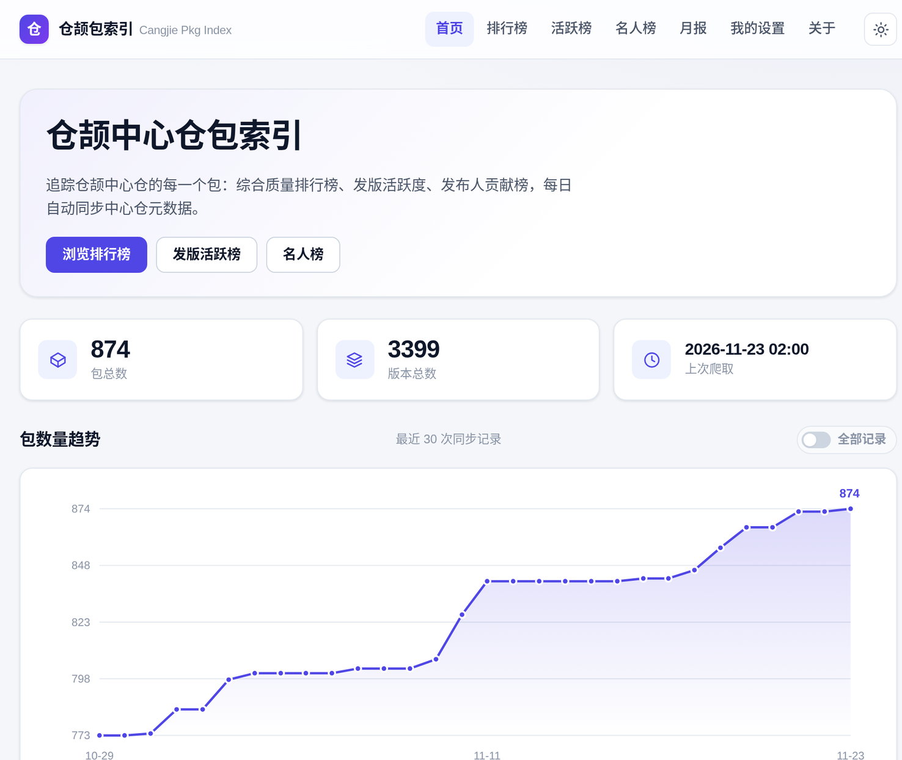
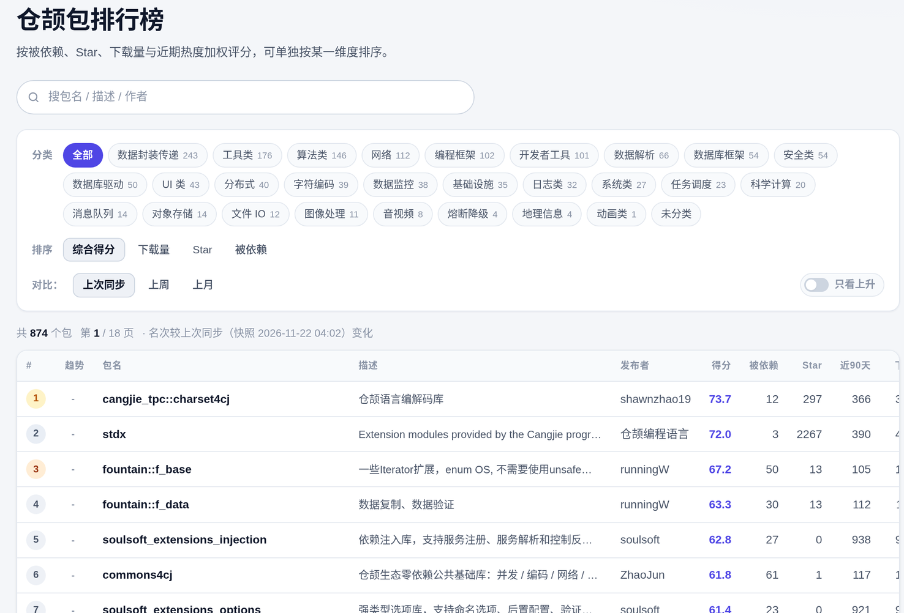
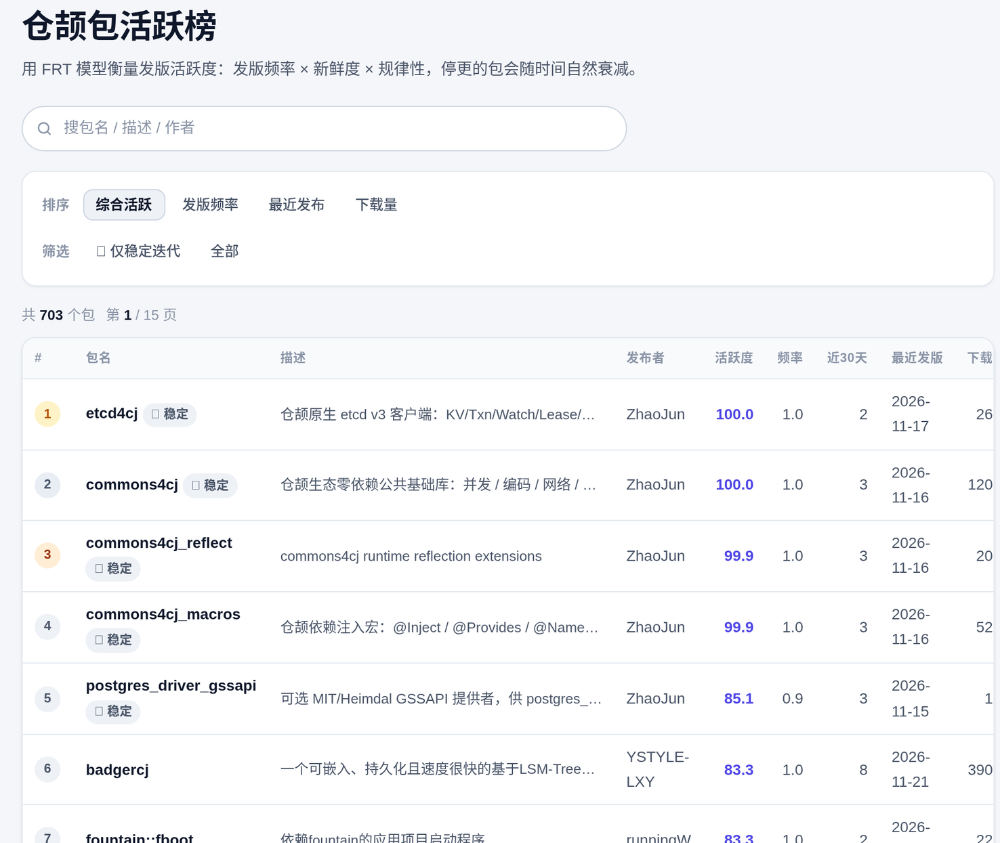
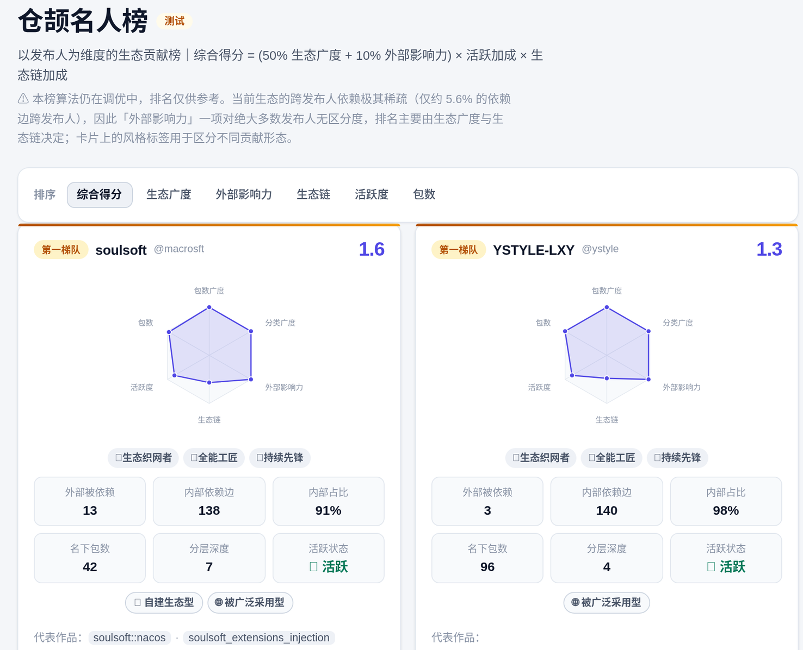
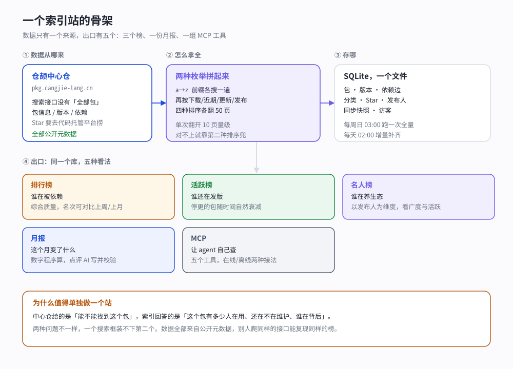

仓颉中心仓的搜索框只回答一个问题：**有没有这个包**。

但大家真正关心的是另外三件事：这个包有多少人在用、它还在不在维护、背后是谁在写。这三件事，搜索框不答。

所以我做了个站，把中心仓的公开元数据每天爬一份下来，算成三张榜，再开两个 MCP 入口给 agent 用。地址是 [cjpi.ystyle.top](https://cjpi.ystyle.top)。



## 一句话说清它是什么

每天凌晨两点从中心仓同步一次，白天你看的所有数字都是那一份快照。三张榜各观察一个维度，另外每月初有一份月报，说这个月变了什么。

数据全部来自中心仓的公开接口。包信息、版本历史、依赖关系都是公开的，任何人对同一份数据跑同样的规则，会得到同样的结果。

## 先说一个具体的毛病：搜不到

中心仓的搜索是**前缀扫描**：拿关键词去比包名的开头，只认「以这几个字母开头」。所以你得先知道包名叫什么才搜得出来，记错一个字符就没有结果；想按「这是干什么用的」或者「这是谁写的」去找，做不到。

索引站这边的搜索是子串匹配，包名、描述、发布人三个字段都能搜：输入 `etcd` 能出来 `etcd4cj`，输入「数据库驱动」能列出一排，输入某个发布人的 ID 能把他名下的包全部列出来。

这个差别也是后面那套枚举办法的由来——接口本身只认前缀，所以想拿全量，只能自己把前缀一个个试过去。

## 排行榜：看包

第一张榜按综合质量排，四项指标加权：被依赖、Star、近 90 天下载、累计下载。也可以撇开综合分，单独按某一维度排——有人更关心「谁真的在用」，就会直接看被依赖那一列。



麻烦在 Star 怎么算。

Star 是仓库级指标，代码托管平台只给仓库的数字，不给模块的。而排行榜排的是模块。一个 monorepo 拆成 48 个模块，如果每个模块都拿整个仓库的 Star，这一个仓库能占掉前 15 名里的 11 席——这事我在自己那份数据上撞见过。

现在的做法是：同一个仓库下的模块**均分**这个仓库的星数；只对应一个包的仓库完全不受影响。均分是个中性的假设——这些星是仓库整体挣来的，没有模块级的依据可以加权。

## 活跃榜：看迭代

第二张榜不看有多少人在用，只看还在不在发版。



874 个包里，有发版记录的只有 703 个。剩下的建了包但一个版本都没发过，榜上自然看不到。

这张榜踩过一次坑。最早用的是「最近 30 天发版几次、90 天发版几次」这种固定窗口，看着直观，但窗口是硬的：一批发版在同一天集体滑出 30 天窗口，那天的分数整个塌下来，第二天又没事。一个一直在稳定发版的人，会在某个平平无奇的早上掉到榜尾。

后来改成按时间连续衰减：越近的发版权重越高，越远的越低，没有一刀切的那一天。同样是看近期活跃，曲线从断崖变成了斜坡。

## 名人榜：看人

第三张榜换成发布人视角：谁名下包多、覆盖面广、还在发版。



当前生态里跨发布人的**依赖边**只占大约 5.6%。也就是说，绝大多数包只被同一个人名下的其他包依赖。

这带来一个直接后果：「外部影响力」这一项，对绝大多数发布人没有区分度。榜上排在前面的主要靠包数多、分类覆盖广——等于自己织了一张网。

算法也还在调，所以页面上直接写了「仅供参考」。

## 这些数据是怎么拿全的



中心仓的搜索接口没有「列出全部包」这种能力。它是前缀扫描，一次只返回以某个前缀开头的那一批，一页最多 100 条。

所以拿全得用两种方式互相兜底：

1. 按首字母 a 到 z 各扫一遍——包名都以字母开头，这一圈能覆盖绝大多数；
2. 再按四种排序（累计下载、近期下载、最近更新、最新发布）各往后翻页，捞前缀扫描漏掉的。

两路结果合起来去重，就是全量。增量轻松一些：每天只翻「最近更新」和「最新发布」的前几页。

Star 数和依赖关系中心仓没有，得单独去补。这部分最慢，所以放在每周日凌晨的全量任务里跑。

## 分类也是自己打的

中心仓给的分类不全，不少包干脆没有分类。所以分类是自己打的：用本地跑的模型给每个包生成标签，现在一共 27 个分类。

最大的两类是**数据封装传递 243 个、工具类 176 个**——这两个数字能看出当前生态的重心：序列化、协议类的包最多，其次是各种工具。

标签打出来以后还有个更麻烦的问题：要不要复审。

模型不是确定性的，同一批包跑两次，可能一次标成 UI 类、一次标成开发者工具。我试过最简单的做法——复审时不一致就覆盖，结果前六个复审过的包里有两个被改差。

现在接第二个模型做仲裁：只有它比原来那批标签更有把握时，才允许改写。多一步，但标签不会越审越乱。

## 月报：数字程序算，点评模型写

每月初出上一个完整自然月的报告。当月数据不计入，只覆盖已闭合的月份——不然月报的数字天天变，没法引用。

数字部分由程序算，可以复现；点评和结论由模型写，但每一段都要回头校验它引用的数字是不是真在报告里。最新两份：2026-10 新增 55 个包、470 次发版；2026-09 是 139 个和 589 次。

## 给 agent 用的那部分

站点是给人看的，另外有两个 MCP 入口给 agent 直接查，工具都是五个：搜包、包详情、排行榜、活跃榜、名人榜。

**本地二进制**是推荐先用的一种：不用账号、不用联网、不限次数。它内置约 1.3 MB 的精简索引，只有元数据：

```json
{
 "mcpServers": {
  "cangjie": {
   "command": "npx",
   "args": ["-y", "cangjie-pkg-index"]
  }
 }
}
```

想要完整数据（含 README 全文）跑一次同步，大约 3 MB：

```bash
npm install -g cangjie-pkg-index
cjpi-pkg-index sync
```

**远程服务**不用装东西，但要有合作组织成员身份和一次授权——OpenCangjieCommunity、CjKu、IgKit、HapPub、mpv-ohos、LiquidStudio 任一个都行。认证可以走 OAuth，也可以直接在「我的设置」里生成一个 API key 填进请求头。

两边工具集完全一样，差别只在数据来源：本地版读你机器上的索引，远程版读服务器那份，永远最新。

## 它不做什么

**它不是官方搜索的替代。** 要找某个包，去中心仓搜更快更准——那是第一手数据，我这是二手。

**数据有一天的延迟。** 每天凌晨同步一次，白天发的版要到第二天才进榜。

**分类会错。** 就是上面那种「同一批包两次标成两类」，在边界模糊的包上最明显。

**榜单衡量的不是「谁更好用」。** 被依赖多、发版勤，说明有人维护、有人在用，不等于适合你的项目。选包还是要自己看文档、跑一遍。

这四条里，一半是我这边还没做够，另一半本来就不该由榜单回答：前者能改，后者改了也没用。

---

站点地址：[cjpi.ystyle.top](https://cjpi.ystyle.top)。每个维度的算法和权重写在页脚的「关于」里。
