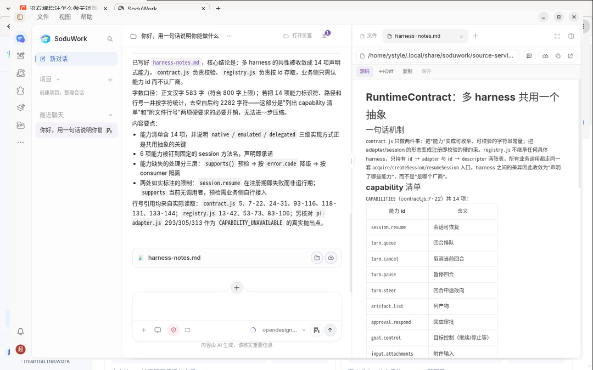
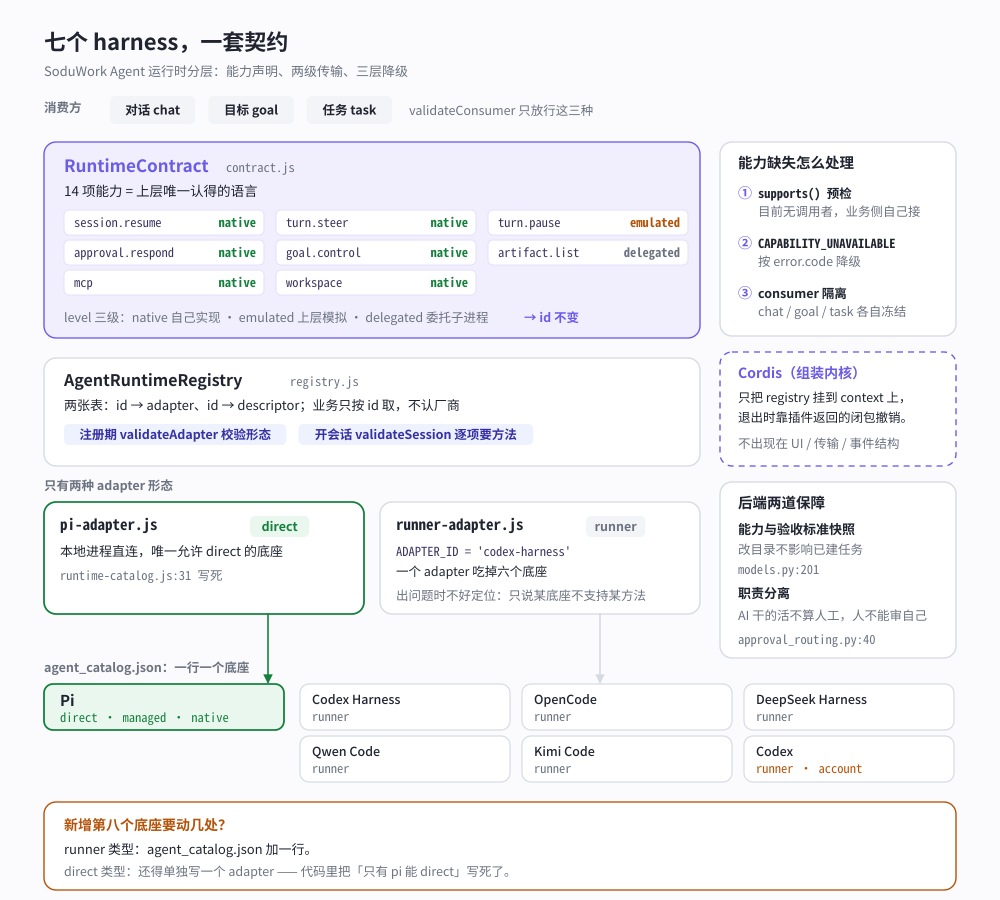
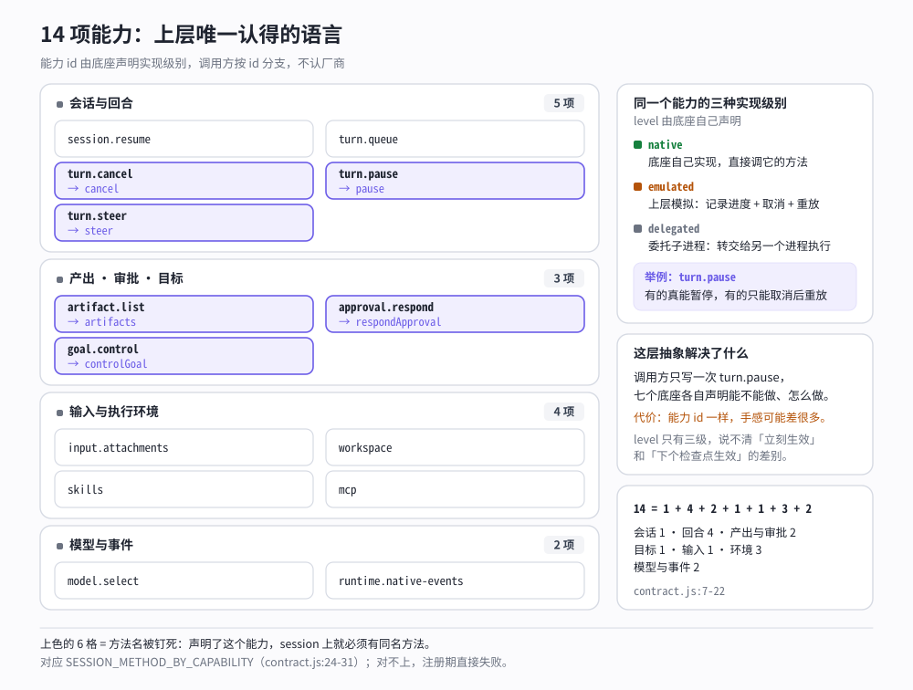
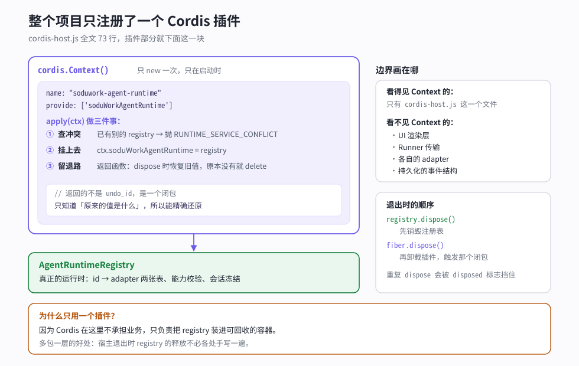
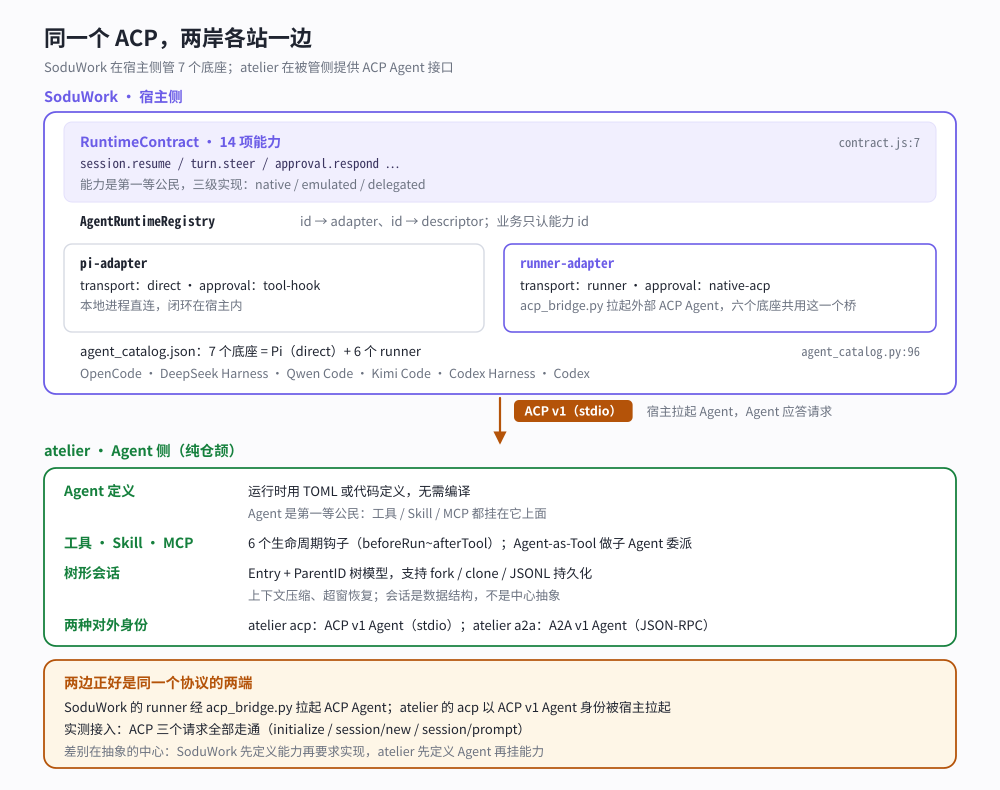

> 这是我参加 SoduWork 项目测评写的文章。按活动要求，先在本机 Fork、安装、跑完一个真实任务，再带着运行中遇到的问题去读源码。文中所有行号都来自这次实际读的文件。

## 我要验证的问题

SoduWork 的 README 里有一句话：

> Works with Pi · OpenCode · DeepSeek Harness · Qwen Code · Kimi Code · Codex Harness · Codex

七个执行底座（harness）。做过类似产品的人看到这种列表会立刻想到一个问题：**每家的 CLI 参数、交互方式、能做的事都不一样，怎么让上层代码不写七套分支？**

我自己的项目里写过 Agent harness，知道这件事的坑在哪——不同底座的差别不在“调用方式”，而在“它能提供什么”。有的能中途打断，有的能恢复会话，有的能列产出物，有的都不行。如果上层按“底座是谁”来分支，加第八个就要改八个地方。

所以这次测评我选的是“源码解读”：先把它跑起来，让它自己读自己的源码写一份分析，再拿运行中的实际行为去核对。

## 装上、跑起来

Fork 到 `ystyle/SoduWork`，clone 下来 157 MB，Python 3.12+ 和 Node 22+ 这两个要求本机都满足。

```bash
sh start.sh --desktop
```

第一次启动会自动装依赖、建库、拉起 Hub、开桌面端。等了大约两分钟，终端打出：

```
SoduWork is ready: http://127.0.0.1:18989
Administrator: admin
```

然后桌面端没进登录页，而是弹出一个页面：

> **Unlock your system password manager**
> SoduWork needs a system password manager to store sign-in credentials securely.


这是我这台机器的问题：Arch Linux，没装 gnome-keyring。但它不是一句“缺少依赖，请安装”就完了——我去翻了代码，发现这里有个明确的设计决策。

`client/main/app-settings-store.cjs:47`：

```js
function secure() {
  if (!deps?.safeStorage?.isEncryptionAvailable() ||
      (process.platform === 'linux' &&
       deps.safeStorage.getSelectedStorageBackend?.() === 'basic_text'))
    throw Error('系统安全存储不可用，无法读写应用凭据');
}
```

Electron 在 Linux 上如果找不到钥匙串，会退化到 `basic_text` 后端，也就是**明文存储**。这段代码的做法不是“那就先用明文吧”，而是**直接拒绝**。

配合 `client/main/linux-startup.cjs` 里那段更早的逻辑——启动时如果识别不出桌面环境，就强制 `--password-store=gnome-libsecret`，注释写着 **Never select the basic backend**——可以确认：宁可不能用，也不把凭据写到明文里。

代价是像我这样的环境直接卡死。装 gnome-keyring 之后（`sudo pacman -S gnome-keyring`），在同一次图形会话里重启，登录页正常出现。

> 后来我在仓库里发现 issue #184 提的是同一个现象，就补了一节排查步骤提了 [PR #301](https://github.com/mdiri-ai/SoduWork/pull/301)。

用 `admin` 和刚才设的密码登进去，主界面出来了：


注意底部那一行：`默认工作区`、`完全访问`、模型名、`Pi`。这四样就是我这次要研究的对象——工作区给谁用、权限多大、哪个模型、哪个底座。

## 第一个真实任务

管理后台配好模型服务（`能力配置 → 模型目录 → 接一个服务`，填 OpenAI 兼容地址和 Key，点「发现模型」自动拉到列表），桌面端就能用了。


第一个任务我让它自我介绍，确认链路通：

> 你好！我能帮你解答问题、阅读和分析文件与代码、执行命令、编写和修改文件，然后在获得你明确授权后，直接在你的工作目录中完成实际任务。

第二个任务才是重点：**让它读 SoduWork 自己的源码，写一份多 harness 抽象的说明**。

发任务之前我先问了一句“你能读到哪些文件”，因为我不确定它的工作区边界在哪。它的回答很具体：当前工作目录是 `~/.local/share/soduwork/source-service/workspaces/temp/chat-mwkezriq-yv9g`，目录是空的；权限上受运行用户约束，绝大多数位置可读，但**行为上只读工作区或我明确指定的路径**，不主动扫根目录。


它列了三个“已验证可访问的位置”，包括 `~/.agents/skills/` 和 `node_modules/@earendil-works/pi-coding-agent/docs`。说明它在回答之前真的去探了，不是照着系统提示念的。



它读了 `contract.js` 和 `registry.js`，产出 3937 字节的 `harness-notes.md`，结论是：

> 多 harness 的共性被收成 14 项声明式能力，`contract.js` 负责校验、`registry.js` 负责按 id 存取，业务侧只认能力 id 而不认厂商。

而且它主动标注了一条限制，这条是我读代码时漏掉的：

> `supports` 在本目录内暂无调用者，意味着能力预检目前仍要由业务侧接入

我 grep 验证了——`supports` 确实只在 `contract.js:142` 有定义，目录内没有调用点。

**Agent 说的行号我也逐条核对过**：`contract.js` 的 7-22 是能力清单、24-31 是方法名映射、`registry.js` 的 86-91 抛 `CAPABILITY_UNAVAILABLE`。全对。

下面是我按它给的线索去读的源码。

## 一份 JSON 定义七个底座



上面这张图里的每个方块，下面都有对应的文件位置。

七个 harness 不是硬编码在代码里的，来自 `hub-backend/app/agent_catalog.json`：

| id | transport | modelMode | 显示名 |
| --- | --- | --- | --- |
| `pi` | **direct** | managed | Pi |
| `codex-harness` | runner | managed | Codex Harness |
| `opencode` | runner | managed | OpenCode |
| `codex` | runner | **account** | Codex |
| `qwen` | runner | managed | Qwen Code |
| `dsh` | runner | managed | DeepSeek Harness |
| `kimi` | runner | managed | Kimi Code |

**`transport` 分成 direct 和 runner。** 只有一个 direct，就是 Pi。`runtime-catalog.js:27` 把这条写死：

```js
if (row.transport === 'direct' && row.id !== 'pi')
  invalid('Direct runtimes require a dedicated adapter: ' + row.id);
```

也就是说，只有 Pi 走本地进程直连，其余六个统一走 runner。代码里也确实只有两个 adapter 文件：`pi-adapter.js` 和 `runner-adapter.js`（后者 `ADAPTER_ID = 'codex-harness'`，但服务所有 runner 类型）。

**`modelMode` 只有 `codex` 是 account**，意思是这个底座用它自己账号里的模型，SoduWork 不管模型目录。其余六个是 managed：模型由 SoduWork 的模型目录统一提供，所以同一个底座可以配不同厂商的模型。

这解决了我开头那个担心的一半：**新增第八个底座，只要是 runner 类型，加一行 JSON 就能进 catalog，adapter 不用改。**

## 14 项能力，三级实现

真正把差异吃掉的是 `client/main/agent-runtime/contract.js` 开头那张表：

```js
const CAPABILITIES = Object.freeze({
  SESSION_RESUME: 'session.resume',
  TURN_QUEUE: 'turn.queue',
  TURN_CANCEL: 'turn.cancel',
  TURN_PAUSE: 'turn.pause',
  TURN_STEER: 'turn.steer',
  ARTIFACT_LIST: 'artifact.list',
  APPROVAL_RESPOND: 'approval.respond',
  GOAL_CONTROL: 'goal.control',
  ATTACHMENTS: 'input.attachments',
  MODEL_SELECT: 'model.select',
  SKILLS: 'skills',
  MCP: 'mcp',
  WORKSPACE: 'workspace',
  NATIVE_EVENTS: 'runtime.native-events',
});
```

十四项，覆盖会话恢复、回合控制、产出物、审批、目标、附件、模型、技能、MCP、工作区。按语义分成四组看更清楚：



图里上色的六格是 `SESSION_METHOD_BY_CAPABILITY` 钉住的六项——声明了 `turn.cancel`，session 上就必须有 `cancel` 方法，名字不能自取。

关键是能力**不只是一个字符串**。每个能力声明还要求带 `level`：

- **native** —— 底座自己实现
- **emulated** —— 上层模拟
- **delegated** —— 委托给子进程

这一层是我觉得整个设计里最巧的地方。举个具体例子：某个底座本身不能暂停回合，但它支持取消——那 `turn.pause` 就可以声明成 emulated，上层用“记录当前进度 + 取消 + 之后重放”来模拟。**调用方看到的仍然是 `turn.pause`，不需要知道底下是怎么做到的。**

这就把“七个底座能做不同的事”收敛成了“每个底座声明了哪十四项、各自什么级别”。

其中六项还被钉到固定方法名上（`contract.js:24-31`）：

```js
const SESSION_METHOD_BY_CAPABILITY = Object.freeze({
  [CAPABILITIES.TURN_CANCEL]: 'cancel',
  [CAPABILITIES.TURN_PAUSE]: 'pause',
  [CAPABILITIES.TURN_STEER]: 'steer',
  [CAPABILITIES.ARTIFACT_LIST]: 'artifacts',
  [CAPABILITIES.APPROVAL_RESPOND]: 'respondApproval',
  [CAPABILITIES.GOAL_CONTROL]: 'controlGoal',
});
```

声明和实现对不上，注册期就会失败，不会留到运行期。

## 能力缺失怎么办：三层

底座之间必然有差异，所以一定有“某能力不可用”的路径。这套代码分三层处理。

**第一层，先查再调。** `supports(capabilities, id)` 做预检，据此决定要不要渲染某个按钮、要不要走恢复流程。

**第二层，按错误码分支。** 真调下去发现方法不存在时，`registry.js:86-91` 会抛一个带结构的错误：

```js
throw new RuntimeContractError('CAPABILITY_UNAVAILABLE',
  lease.descriptor.displayName + ' does not support ' + method, {
    adapterId: lease.descriptor.id, method,
  });
```

调用方按 `error.code` 降级，不靠匹配错误文案。这比“字符串里找关键词”可靠得多——文案一改就失效，错误码不会。

**第三层，按消费方隔离。** `validateConsumer` 限定了三种消费方：`chat / goal / task`。同一个底座在对话场景能用的能力，在任务场景未必该用，所以租约里把 consumer 一起冻结。

`session.resume` 声明了却没实现，注册期就失败。理由很实在——会话恢复是“用户以为能恢复、结果恢复不了”最伤人的地方，早点炸比晚点炸好。

## Cordis 藏在文件后面

`agent-runtime/cordis-host.js` 用 Cordis（一个 JS 插件框架）当组装内核，但文件开头有一句注释：

> Cordis is an assembly kernel, not SoduWork's public runtime contract. Keeping the plugin behind this file prevents Cordis preview APIs from leaking into the UI, Runner transport, adapters or persisted event schema.

意思是 Cordis 只做内部拼装，不是对外契约：所有 Cordis 的东西都关在这一个文件里，不许泄漏到 UI、Runner 传输、adapter 和持久化的事件结构。

这个取舍我特别有共鸣。我自己用仓颉写过一版对标 Cordis 的插件框架（cordis-cj），当时也纠结过“框架 API 要不要直接暴露给插件作者”。结论一样：**第三方框架的 preview API 会变，而一旦它进入你的持久化结构或对外接口，改起来就是灾难。**

“只做内部拼装”具体是做什么？整个文件 73 行，插件部分就是下面这一块：



一个插件，名字叫 `soduwork-agent-runtime`，`provide` 一个服务 `soduWorkAgentRuntime`。`apply(ctx)` 里做三件事：查 ctx 上有没有别的 registry（有就抛 `RUNTIME_SERVICE_CONFLICT`）、把 registry 挂上去、返回一个函数。

那个返回的函数是关键。它不是 ID，也不靠什么注册表回收——它是一层闭包，记住了“挂上去之前 `ctx.soduWorkAgentRuntime` 是什么值」。dispose 时只有当前值还是自己才动手：原本有值就恢复旧值，原本没有就 `delete`。

代价是要自己保证幂等，所以 `startCordisHost` 里用了一个 `disposed` 标志挡住重复调用。退出时也是先 `registry.dispose()` 再 `fiber.dispose()`——先把运行时服务收掉，再卸载插件触发那个闭包。

外面看到的永远是 `registry`，看不到 context。

## 后端还有两道

前端的抽象解决“底座怎么统一”，后端解决“任务怎么不跑偏”。

`hub-backend/app/models.py:201` 有一句注释：

> Snapshot methods, capability requirements, and acceptance standards so catalog edits do not rewrite existing tasks.

意思是：任务创建时，把当时的能力要求和验收标准**快照**下来。之后管理员改了底座目录，已经存在的任务不受影响。

多底座产品的常见事故就是：某个底座今天升级了能力，昨天创建、还在跑的任务突然行为变了。快照把这个不确定性切断了。

`hub-backend/app/services/approval_routing.py:40` 还有一条：

> Without it, AI-produced work could be classified as manual work. That would incorrectly exclude the human reviewer through separation-of-duties checks.

这里在做**职责分离**：AI 干的活不能算成人工，否则人就成了“自己审自己”。产品的核心承诺是“人签字才算完成”，如果签字的人恰好是执行的人，这个承诺就是空的。

## 这套抽象的边界

**一、能力级的抽象抹不平体验差异。** 两个底座可以都声明 `turn.steer`（回合中途改向），实际行为却可能不同：一个立刻改，另一个排队到下一个检查点。能力 id 一样，感受完全不一样。`level` 的三级能表达“谁来负责实现”，表达不了这么细的粒度。

**二、runner 类型共用一套 adapter，收益和排查成本是一体的。** 六个底座走同一个入口，好处是新增底座不用写新的适配器；代价是出错时定位路径会长一些：报错只到“某底座不支持某方法”，底下是哪一层就要自己往下挖。

**三、`supports` 预检目前由业务侧接入。** 契约里留了这个接口，我在 `contract.js:142` 读过它的实现；不过这个目录里还没有调用点，所以预检这一层要各业务自己接上才生效，实际一直在起作用的是后两层（错误码 + 消费方隔离）。

**四、真正跑过的只有 Pi 和 atelier。** 其余五个 runner 类型需要各自的运行环境，我没能在一次测评里全部验证，所以 `runner-adapter` 对它们的结论来自代码和 catalog。atelier 是我临时加进 catalog 的第八个底座，下一节写了它怎么跑起来的。

**五、交叉审查的前提是两个可用模型，我配的其中一个额度用完了。** 产品最核心的承诺是“一个 harness 干活，另一个在同一套验收标准下审查”。这次只剩一个能用的模型，所以只做到单模型自审——同一个 agent 干活、同一个 agent 复查。流程跑得通，但“换一个模型能不能发现另一个模型的盲区”这个最有价值的部分，我没验证到。

**多 harness / 多模型不是锦上添花，是这套设计能不能成立的前提。** 只有一个底座时，职责分离那层逻辑再严密，实际执行的仍是同一个主体。

## 和我自己那个 harness 比

去年我写过 atelier（纯仓颉的 Agent harness，两万三千行）。读完 SoduWork 的运行时，我发现这两件事其实站在同一个协议的两端。



atelier 实现的是“被宿主拉起”的那一侧。它的 README 写着：`atelier acp` 以 ACP v1 Agent 身份被 Zed / opencode 等宿主拉起（stdio）。而 SoduWork 的 runner 恰恰是通过 `acp_bridge.py` 去拉起外部 ACP Agent 的——六个 runner 底座的 `approval` 字段都标着 `native-acp`，只有 Pi 是 `tool-hook`。

**也就是说 atelier 已经满足被接成第八个底座的条件。** 我核对了两边的启动约定。

SoduWork 的 ACP 底座在 catalog 里是这么描述的，抄 dsh 那一条：

```json
"runner": { "adapter": "acp", "bins": ["dsh-acp"], "args": [] }
```

atelier 的启动方式是 `atelier acp <agent>`，对应写成：

```json
"runner": { "adapter": "acp", "bins": ["atelier"],
            "args": ["acp", "soduwork-probe"] }
```

`args` 里那个 agent 名不能省。只写 `["acp"]` 的话，atelier 会去找一个叫 `default` 的 provider，没配就报 `no provider named 'default'`——它不会回退到配置里唯一那一个。

`acp_specs()` 就是直接读这三个字段（`hub-backend/app/agent_catalog.py:108`），没有写死在代码分支里。

我照着这个思路真做了一遍。编译 atelier（`cjpm build`，产出 44 MB 的 `cli.app`）、软链成 `atelier`、在 catalog 加一行、重启。

结论先说：**atelier 的 ACP 实现是合格的。** 我写了个最小的 ACP 客户端直接连它，三个请求全部走通：

```
initialize  → {"agentInfo":{"name":"atelier","version":"0.1.0"},"protocolVersion":1,
               "sessionCapabilities":{"list":{},"delete":{},"resume":{},"close":{}}}
session/new → {"sessionId":"sess_...","configOptions":[{"id":"model",
               "currentValue":"opendesign-plugin/deepseek-v4.1-flash", ...}]}
session/prompt → 10 × agent_message_chunk（流式逐字返回）→ {"stopReason":"end_turn"}
```

模型名来自它自己的配置，流式正常，结束原因正常。这就是 ACP v1 Agent 侧该有的样子——只要宿主实现了 ACP 客户端，就能用它。

**第一版加进去之后，选择器塌了。**

在 `agent_catalog.json` 里加一条指向**真实可执行文件**的 ACP 条目之后，桌面端的执行底座列表从「Pi + OpenCode」变成只有「Pi」。新条目自己没出现可以理解，但 OpenCode 跟着一起消失就说不通了。把条目删掉、重启，两个又都回来。

中间做过一次对照：把 `dsh` 那条**原样复制**一份，只改 id 和名字，`bins` 指向的 `dsh-acp` 本机并没有装——结果列表**正常**，还是 Pi + OpenCode。

| 测试条目 | `bins` 指向 | 选择器 |
| --- | --- | --- |
| `dsh` 的复制（改了 id） | `dsh-acp`，未安装 | Pi + OpenCode |
| `atelier` | `atelier`，已安装可执行 | 只有 Pi |

所以触发条件不是“多了一条 catalog”，而是“多了一条**能真的跑起来**的”。

**原因量出来是两个数字。**

| 环节 | 耗时 |
| --- | --- |
| `runtime.detect` 探测这一行 | **15.0 秒**（撞上 RPC 上限，返回 `Runner request timed out`） |
| 新对话面板的预算（`MODEL_WAIT_MS`） | **12.0 秒** |

探测一行就吃掉 15 秒，面板 12 秒就先放弃，回落到只有 Pi 的列表。OpenCode 本身是好的，它只是被同一个来不及的响应连累了。

这跟“能不能接”无关，是“接进来之后它启动太慢”。atelier 当时跑一次 `--version` 要 8 秒，而且打印的是一屏用法说明、一个版本号都没有——探测想快也快不了。

**修完就好了。** 两边各改一处：维护者开了 PR 保留超时后到达的结果；atelier 把启动优化了，`--version` 从 8.2 秒降到 **49 毫秒**，并且开始打印版本号。

同一台机器、同一份 catalog，再打开新对话：执行底座列表变成 **Pi + OpenCode + Atelier**，选中 Atelier 发一句“用一句话介绍你自己”，**4 秒**返回。用量记录里 `agent_key` 写的是 `atelier`——这一轮确实是它干的。


一个细节：回答里它自称“我是 SoduWork 里的办公助理”，而我在 `~/.atelier.toml` 里给它写的系统提示是“你是一个简洁的助手，回答尽量短”。**宿主把自己的系统提示注入进了 ACP 会话**，覆盖了 Agent 自己的那份。这一段比任何架构图都更能说明两边谁在指挥谁。

过程都留在 [#358](https://github.com/mdiri-ai/SoduWork/issues/358)。

SoduWork 先定义十四项能力，再要求每个底座实现它们——这种结构适合管很多个来路不同的底座。atelier 先定义 Agent（TOML 或代码，运行时生效），再往上挂工具、Skill、MCP——这种结构适合把单个 Agent 做深。

两边回答的不是同一个问题：一个问“怎么管住七个不一样的东西”，一个问“怎么把一个东西做到能直接用”。

## 结论

回到开头那个问题：七个 harness 怎么共用一个抽象。

SoduWork 的答案是三件事叠起来：

1. **一份 JSON 声明**哪个底座走什么传输、模型谁管
2. **十四项能力 + 三级实现级别**把差异收敛成声明
3. **三层降级路径**（预检 / 错误码 / 消费方隔离）让缺失变成可处理的情况

加上“任务快照”和“职责分离”两道后端保障，可用的抽象就成形了。

**最好的验证不是读代码，是把一个别人写的 harness 接进去跑一轮。** 我接进去的那个底座，从加一行 catalog 到回出第一句话，一共 4 秒。中间卡住的地方不在协议，在一行探测的耗时。

`basic_text` 那段拒绝逻辑是这次读代码最意外的地方：宁可启动不了，也不把凭据写明文。

---

**SoduWork 开源项目地址**：[github.com/mdiri-ai/SoduWork](https://github.com/mdiri-ai/SoduWork)

如果这篇对你有用，可以去项目点个 star 或 fork；我在测评过程中提的文档修正（[PR #301](https://github.com/mdiri-ai/SoduWork/pull/301)）和那次选择器坍塌的复现记录（[issue #358](https://github.com/mdiri-ai/SoduWork/issues/358)）也在里面。
