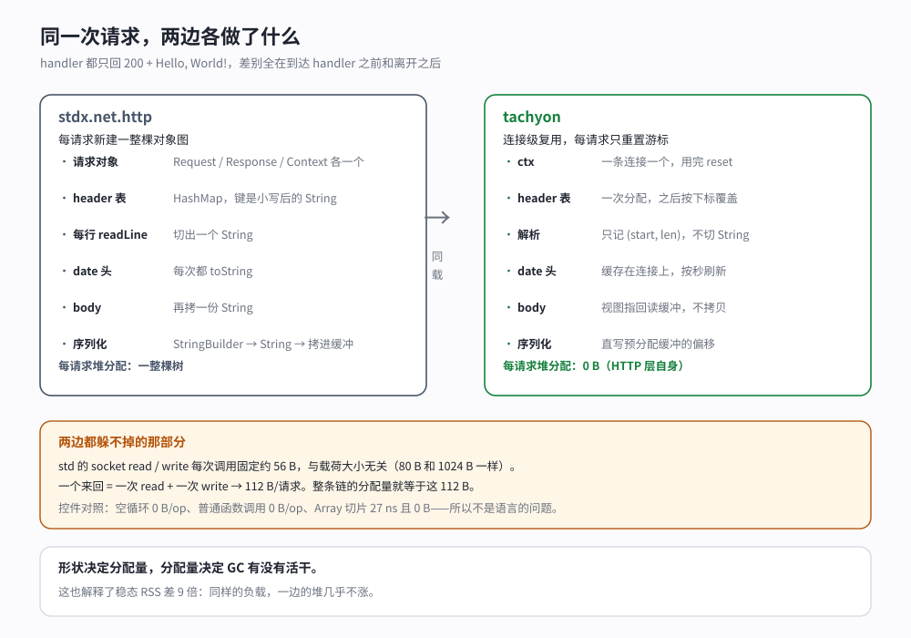

tachyon 是仓颉的一个 HTTP/1.1 服务端，设计照搬 Go 的 fasthttp：per-connection 复用、零拷贝视图、热路径不造 String。实现 19 个文件 4069 行，测试 21 个文件 86 个测试函数，只依赖标准库。

和官方 `stdx.net.http` 比，同一台机器上的数字是这样：

| | QPS | 服务端 CPU/请求 | 稳态 RSS | p99 |
| --- | ---: | ---: | ---: | ---: |
| tachyon | **594,443** | **12.0 µs** | **31.9 MB** | 780–882 µs |
| stdx.net.http | 327,075 | 25.4 µs | 294.8 MB | 1528–1691 µs |

**每请求 CPU 差 2.11 倍，稳态内存差 9.2 倍。**

这组数字是这次在这台机器上重新跑出来的（AMD Ryzen 7 7840HS，16 线程）。

而且这不是一组孤立的实验室数据：`tang` 2.x 已经把 HTTP 层整体换成了 tachyon——它自己的 README 记着同机实测吞吐 2.1 倍、每请求 CPU 约 1/2.2。那个项目是拿它在跑真实应用的。

但光有数字说明不了什么。这篇想讲清楚两件事：**这 2 倍到底花在哪**，以及**这个对比不证明什么**。

## 先定义什么叫“快”

QPS 是最容易看懂、也最容易骗人的指标。压测器和被测服务在同一台机器上跑时，客户端自己也在吃 CPU，所以绝对 QPS 只能同机对比——换台机器、改个连接数，数字就变了。

真正跨环境有意义的是**每请求服务端 CPU**：读 `/proc/<pid>/stat` 的 utime+stime 增量，除以这段时间完成的请求数。它不受客户端噪声影响。

稳态 RSS 则回答另一个问题：这套设计**每请求分配多少东西**。同一个负载下，一边的堆停在 31.9 MB，另一边 294.8 MB，省下的不只是内存，还有 GC 的活。

三个口径凑齐，才能说清一件事。我试过 `cjHeapSize=2g/8g` 和 `cjGCInterval`，两边 RSS 都没变——9 倍的差不是参数调出来的。

## 怎么测的

压测器是自己写的一个 Go 工具，两边跑同一个二进制。同机、128 条长连接、10 秒、keep-alive，交替多轮取中位。

两个 handler 对齐到最小：都只回 `200` 加一行文本；tachyon 那边还多写一个 `Content-Type` 头，对它不利。优化级别两边都是 `-O2`——cjpm 默认不开，不开的话这个对比没意义。

## 2 倍花在哪：API 形状

两边都是仓颉，差的是**API 形状决定了每请求分配多少东西**。

拆开看三个具体决定：

**一、对象模型 vs 连接级复用。** stdx 的 `HttpRequest` / `HttpResponse` / `HttpContext` / header 表都是对象，每请求新建一棵；tachyon 一条连接一个 ctx，用完 reset，header 表按下标覆盖。

**二、热路径不造 String。** 仓颉的 `String` 是带 UTF-8 校验的堆对象。stdx 每请求要造十几个：每行 `readLine`、每个 header 名小写、date 的 `toString`、body 的 `toString`。tachyon 全程 `Bytes{buf, start, len}` 视图 + 索引对。

**三、序列化直写缓冲。** stdx 是 `StringBuilder → String → 拷贝进 socket 缓冲`；tachyon 直接写预分配缓冲的偏移，一次 `write` 出去。

## 那剩下的 112 字节

tachyon 的 HTTP 层是 **0 B/请求**，但整条链每请求仍有 112 B 分配。

这 112 B 全部来自标准库的 socket：`read` 和 `write` **每次调用固定约 56 B，与载荷大小无关**——写 80 字节和写 1024 字节都是 56 B。一个来回 = 一次读 + 一次写，正好 112。

对照组说明这不是语言的问题：空循环 0 B/op、普通函数调用 0 B/op、`Array` 切片 27 ns 且 0 B/op（是别名，不是深拷贝）。

我原以为这 56 B 是数组切片造成的，量完才知道切片是 0 B/op，全部在 socket 里。下一篇细讲热路径上这几笔隐形开销。

## 这组数字能推到哪

**一、没跑 profiler。** 2.11 倍是端到端测出来的。上面每一条都是源码事实，但“哪一项占多少微秒”是推断，不是 profile 数据。

**二、功能面不对等，是刻意的。** tachyon 不做 HTTP/2、不做 TLS、没有 URL 对象模型（不解析 scheme/authority）、header 校验比 stdx 少。stdx 是通用 HTTP 实现，tachyon 只做 HTTP/1.1 服务端并把所有非必要工作砍掉。**要求功能对等的场景，差距会缩小。** 这正是 fasthttp 相对 Go net/http 的位置。

**三、同机回环。** 这一组的绝对值——59 万对 32.7 万——只在这台机器、这个连接数下成立，换台机器或改连接数就变。

## 换个环境再测一次

回环跑在理想条件下，所以又做了一组：**Windows 客户端 → Linux 服务端，走局域网**，压测工具换成 bombardier，每档 20 秒：

| 连接数 | tachyon 服务端 CPU/请求 | stdx 服务端 CPU/请求 | 比值 |
| ---: | ---: | ---: | ---: |
| 128 | 13.0 µs | 24.4 µs | 1.88 |
| 256 | 13.6 µs | 23.7 µs | 1.74 |
| 512 | 14.3 µs | 25.2 µs | 1.76 |
| 1024 | 17.4 µs | 29.1 µs | 1.67 |

**换了机器、换了网络、换了工具，比值落在 1.67–1.88**，和回环那次的 2.11 是同一个量级。

这组还带出另一件事：连接数往上加，stdx 的吞吐反而**下降**（18 万 → 17.7 万 → 17 万 → 15.2 万），延迟超线性上升。tachyon 也在降，但拐点更晚，绝对延迟始终约为它的一半。

那 20 秒里 tachyon 只用了约 5/16 核。也就是说这组数字反映的是“局域网 + 单连接一次一个请求”下的上限——**往返 1 ms 时，吞吐上限 ≈ 连接数 ÷ 往返延迟**，所以加连接才涨；而每连接自身的开销从某个点开始反噬——stdx 的每连接成本更高，所以它在更早的档位就开始掉。测到这里已经不是压服务端 CPU 了——真要压出上限，得有 pipelining 或者更大的连接规模。

## 这 2 倍是换来的

tachyon 的每一处快，都能对应到一处“我不做这个”：没有 HTTP/2、没有 TLS、没有 URL 对象模型、header 校验比 stdx 少。

`tang` 2.0 就是拿这些换的——HTTP 层整体换掉、接受一次破坏性变更。

---

仓库：[atomgit.com/ystyle/tachyon](https://atomgit.com/ystyle/tachyon)（GitHub 上有镜像），`ystyle::tachyon` 已上中心仓（最新 0.2.2）。复现命令、源码级对比、以及上面那组跨机数据都在 `docs/why-faster-than-stdx.md` 里。
